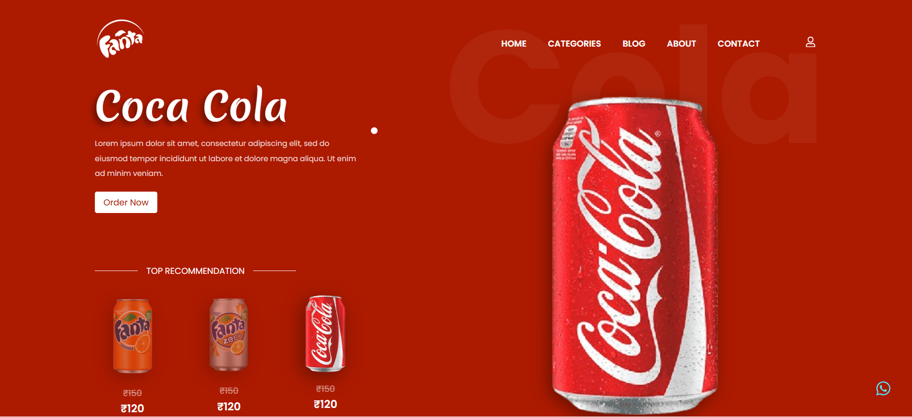
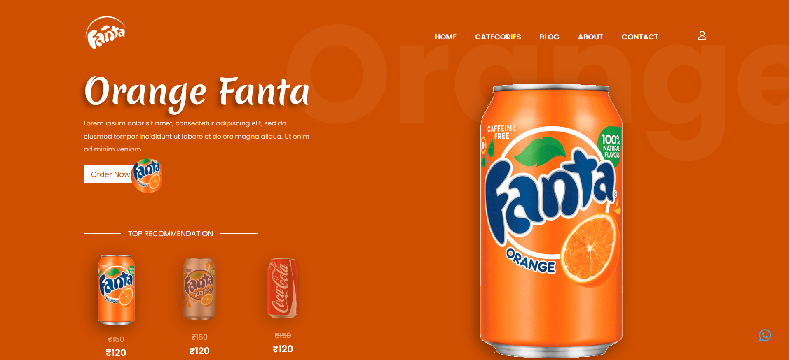

# Fantastick – Interactive Product Landing Page

An interactive and animated beverage landing page built with **React, Vite, Tailwind CSS, and Framer Motion**.

The website features dynamic product selection. When a user clicks on a different beverage can, the entire page smoothly transitions into the selected product's theme, including background colors, product visuals, and animations.

## ✨ Features

- Interactive beverage selection
- Dynamic theme switching based on selected product
- Smooth exit and entrance animations using Framer Motion's `AnimatePresence`
- Animated product transitions
- Dynamic background and text colors
- Hero section with animated product visuals
- Top recommendations section
- Reusable React components

## 🛠️ Tech Stack

- React
- Vite
- Tailwind CSS
- Framer Motion
- JavaScript (ES6+)
- HTML5 & CSS3

## 📸 Screenshots

### Coca-Cola Theme



### Fanta Theme



## ⚙️ Installation & Setup

1. Clone the repository:

   ```bash
   git clone https://github.com/ravikumar-devdesk/fantastick.git
   ```

2. Navigate to the project directory:

   ```bash
   cd fantastick
   ```

3. Install dependencies:

   ```bash
   pnpm install
   ```

4. Start the development server:

   ```bash
   pnpm dev
   ```

5. Open the local URL displayed in your terminal.

## 📦 Production Build

```bash
pnpm build
```

## 👨‍💻 Author

**Ravi Kumar**

- GitHub: [ravikumar-devdesk](https://github.com/ravikumar-devdesk)

---

_This project is created for learning and portfolio purposes. All product names, logos, and trademarks belong to their respective owners._
